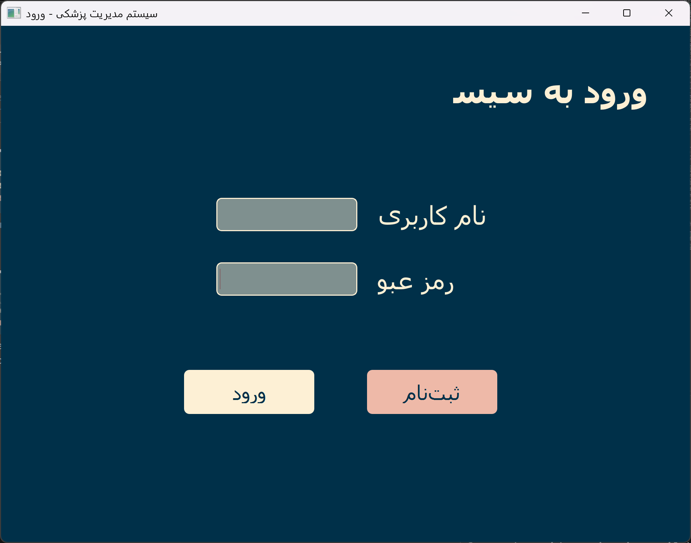
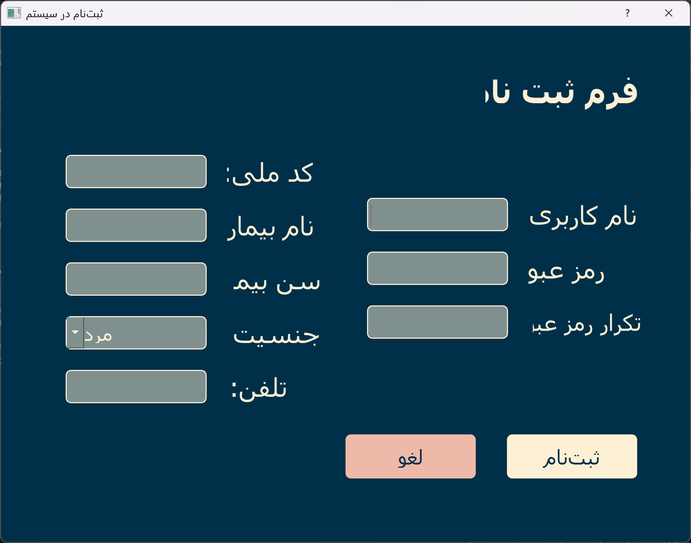
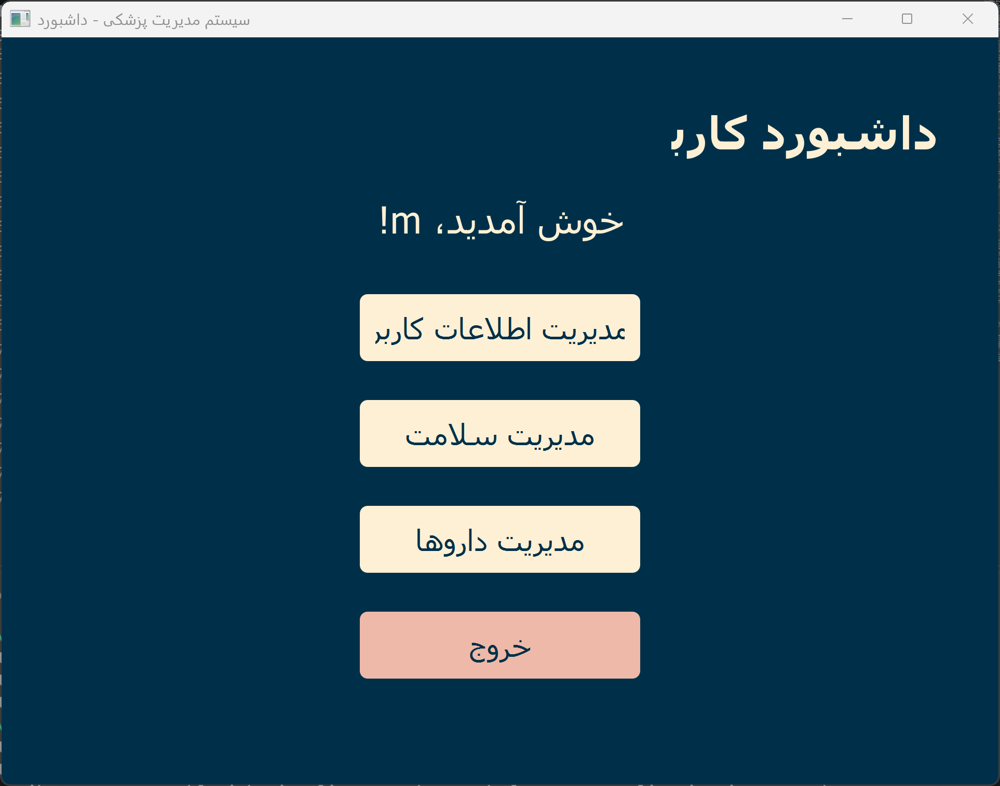
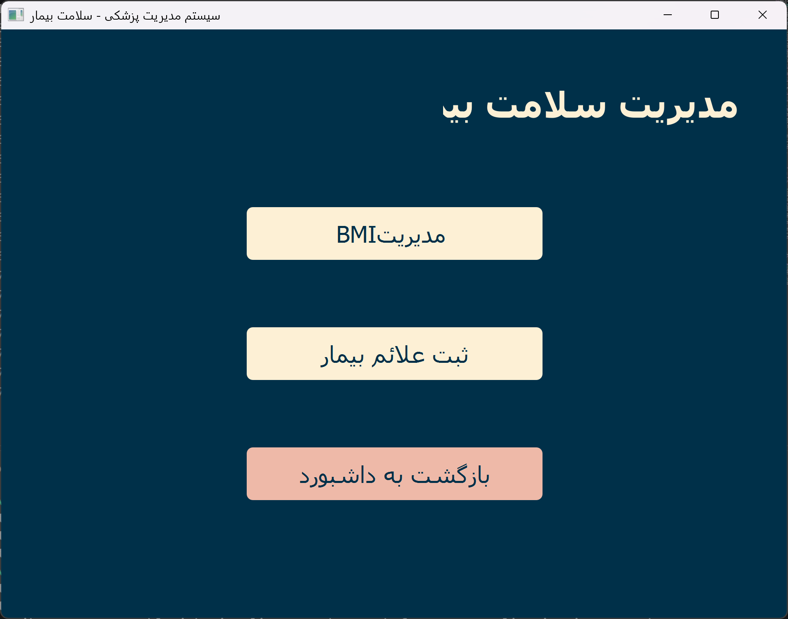
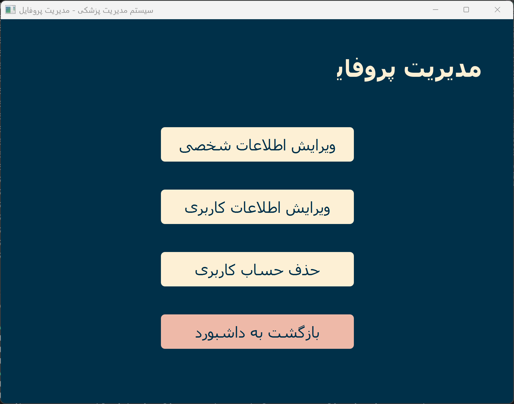
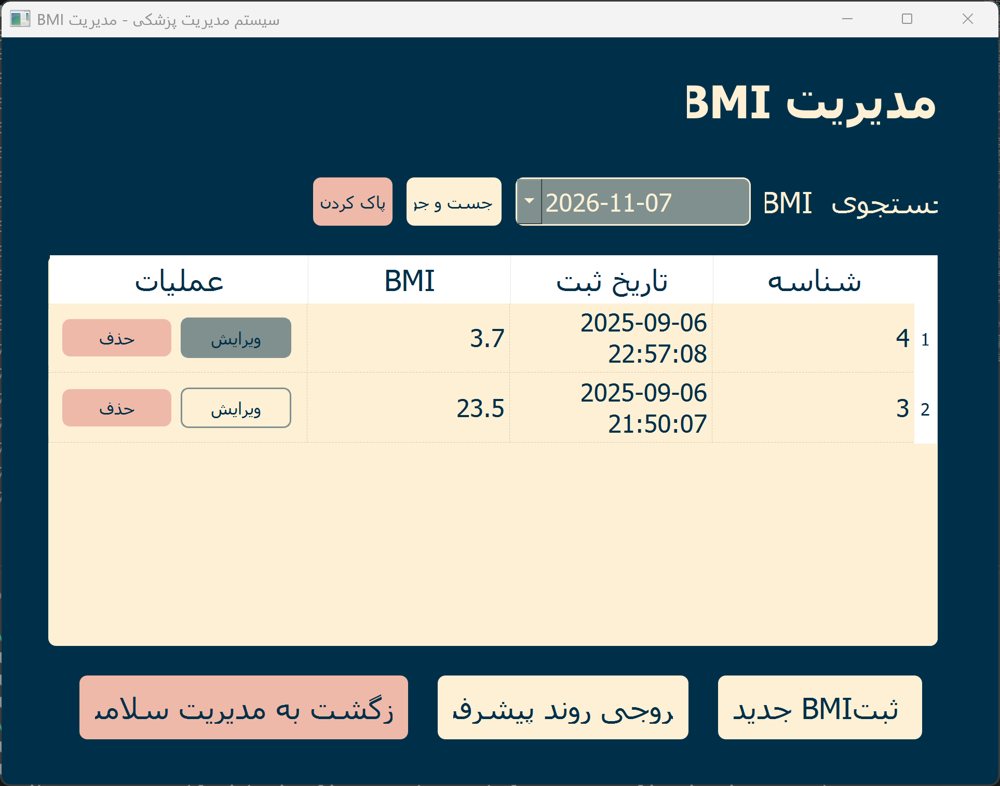
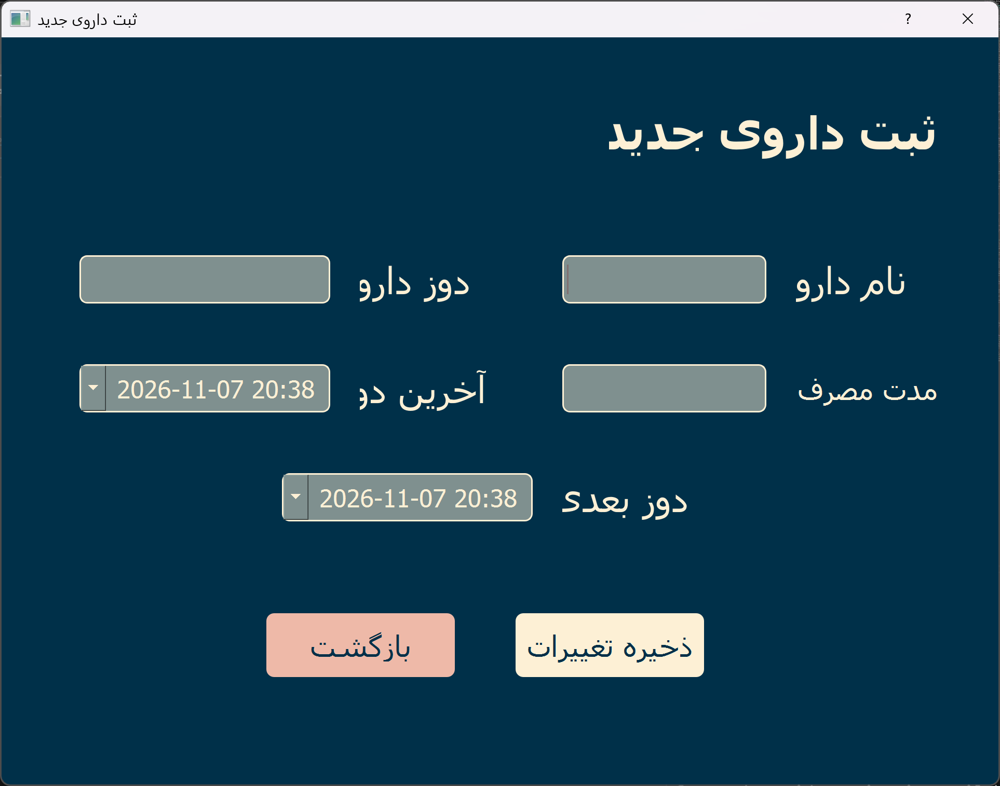
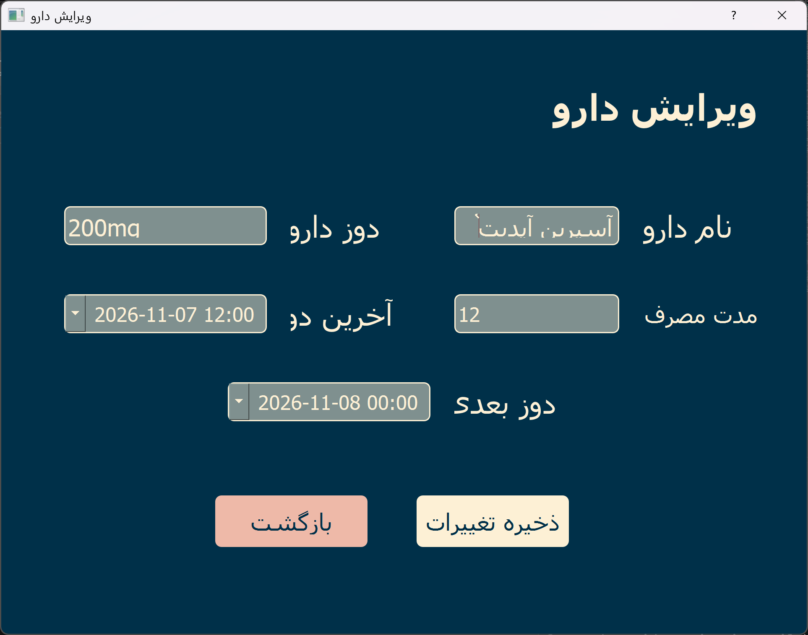

# 🏥 سیستم مدیریت مراقبت‌های پزشکی (Medical Care Management System)

یک نرم‌افزار دسکتاپ جامع و کاربردی جهت پایش سلامت بیماران، ثبت و تحلیل علائم پزشکی، مدیریت داروها و یادآوری دوره‌ای زمان مصرف دارو، توسعه‌داده‌شده با **پایتون (PyQt5)**، پایگاه داده **MySQL** و قابلیت تحلیل هوشمند با **مدل هوش مصنوعی DeepSeek**.

---

## 📸 تصاویر محیط نرم‌افزار

<div align="center">

| صفحه ورود (Login) | صفحه ثبت‌نام (Sign Up) |
|:---:|:---:|
|  |  |

| داشبورد اصلی (Dashboard) | منوی سلامت و پایش (Health Menu) |
|:---:|:---:|
|  |  |

| مدیریت حساب کاربری (Profile) | لیست اطلاعات و سوابق (Records List) |
|:---:|:---:|
|  |  |

| فرم ثبت اطلاعات جدید (New Record) | فرم ویرایش اطلاعات (Edit Record) |
|:---:|:---:|
|  |  |

</div>

---

## ✨ قابلیت‌های کلیدی

### 🔐 ۱. سیستم احراز هویت و مدیریت کاربران
- ثبت‌نام کاربر با اعتبارسنجی جامع اطلاعات (کد ملی ۱۰ رقمی، شماره تماس معتبر، سن و ...)
- ورود امن با استفاده از Stored Procedureهای پایگاه داده
- مشاهده و ویرایش اطلاعات کاربری و پروفایل (نام، سن، جنسیت، شماره تماس، نام کاربری و رمز عبور)

### 📊 ۲. پایش شاخص توده بدنی (BMI)
- محاسبه خودکار BMI بر اساس قد و وزن واردشده
- ذخیره تاریخچه محاسبات در پایگاه داده
- فیلتر و جستجوی سوابق بر اساس تاریخ
- **رسم و خروجی نمودارهای تحلیلی روند تغییرات** (قد، وزن و BMI در طول زمان با استفاده از `matplotlib` و `pandas` به فرمت‌های PNG، PDF و JPG)

### 📝 ۳. ثبت علائم و تحلیل هوشمند پزشکی
- فرم ثبت سوابق، بیماری‌های زمینه‌ای و علائم جاری بیمار
- ویرایش و حذف علائم ثبت‌شده
- **سیستم توصیه و تحلیل هوش مصنوعی (DeepSeek via OpenRouter):** ارسال داده‌های بیمار به مدل هوش مصنوعی و دریافت تحلیل مختصر، دلایل احتمالی و توصیه‌های مراقبتی به زبان فارسی

### 💊 ۴. مدیریت داروها و اعلان یادآور هوشمند
- ثبت داروهای مصرفی به همراه دوز، فاصله زمانی مصرف (Duration) و زمان دوز بعدی
- ویرایش، حذف و جستجوی داروها بر اساس نام
- **یادآور خودکار (Medicines Reminder):** بررسی دوره‌ای در پس‌زمینه با `QTimer` و نمایش پاپ‌آپ اخطار جهت یادآوری زمان مصرف دارو، با به‌روزرسانی خودکار زمان مصرف بعدی

---

## 🛠 تکنولوژی‌های مورداستفاده

- **زبان برنامه‌نویسی:** Python 3.10+
- **رابط کاربری گرافیکی (GUI):** PyQt5 (طراحی‌شده با Qt Designer)
- **پایگاه داده:** MySQL Server 8.0+
- **درایور اتصال دیتابیس:** `mysql-connector-python` (نسخه پایدار 8.0.x)
- **تحلیل داده و نمودارها:** `pandas` و `matplotlib`
- **هوش مصنوعی:** OpenAI SDK متصل به API کلید OpenRouter (DeepSeek Chat)
- **مدیریت متغیرهای محیطی:** `python-dotenv`

---

## 📁 ساختار پروژه

```text
medical_system/
│
├── app.py                     # نقطه ورود و اجرای اصلی نرم‌افزار
├── requirements.txt           # لیست کتابخانه‌های مورد نیاز پایتون
├── .env                       # فایل حاوی کلید API (در گیت ایگنور می‌شود)
├── .env.example               # نمونه تنظیمات متغیرهای محیطی
├── .gitignore                 # فایل‌های نادیده‌گرفته‌شده در گیت
│
├── database/                  # اسکریپت‌ها و ساختار دیتابیس
│   ├── medical.sql            # ساخت جداول اولیه و داده‌های تستی
│   ├── creating_procedures.sql# کدهای ایجاد Stored Procedureها
│   └── db_diagram.png         # دیاگرام روابط پایگاه داده (ERD)
│
├── screenshots/               # تصاویر محیط برنامه جهت مستندسازی
│
├── views/                     # صفحات و نماهای اصلی
│   ├── login.py               # منطق پنجره لاگین و ثبت‌نام
│   ├── dashboard.py           # منطق داشبورد اصلی
│   └── ui/                    # فایل‌های طراحی Qt Designer (.ui)
│       ├── login.ui
│       ├── signup.ui
│       └── dashboard.ui
│
├── models/                    # ماژول‌های بخش‌های فرعی
│   ├── account.py             # مدیریت حساب و مشخصات کاربر
│   ├── care.py                # مدیریت BMI و علائم بیماری
│   ├── medicines.py           # مدیریت داروها
│   └── ui/                    # فایل‌های طراحی رابط کاربری بخش‌ها (.ui)
│
└── utils/                     # ابزارها و ماژول‌های کمکی
    ├── helpers.py             # اتصال به DeepSeek و تحلیل علائم
    └── reminder.py            # زمان‌بندی و یادآوری مصرف دارو
```

---

## 🚀 راهنمای نصب و راه‌اندازی

### ۱. پیش‌نیازها
- **پایتون:** نسخه 3.10 یا بالاتر
- **سرور MySQL:** نسخه 8.0 یا بالاتر (از طریق XAMPP، WampServer یا نصب مستقیم)

---

### ۲. کلون و آماده‌سازی محیط مجازی

```bash
# رفتن به پوشه پروژه
cd medical_system

# ساخت محیط مجازی (venv)
python -m venv venv

# فعال‌سازی محیط مجازی
# در ویندوز (PowerShell):
.\venv\Scripts\Activate.ps1

# در ویندوز (CMD):
venv\Scripts\activate.bat
```

---

### ۳. نصب وابستگی‌ها

با فعال بودن محیط مجازی، دستور زیر را اجرا کنید:

```bash
pip install -r requirements.txt
```

---

### ۴. تنظیم پایگاه داده MySQL

۱. سرویس MySQL را روشن کنید.
۲. با یک ابزار مدیریت دیتابیس (مانند MySQL Workbench یا phpMyAdmin) متصل شوید.
۳. دیتابیس `medical` را ایجاد کنید و اسکریپت‌های زیر را در آن اجرا نمایید:
   - اجرای فایل `database/medical.sql` جهت ساخت جداول (`users`, `profiles`, `bmies`, `symptoms`, `medicines`).
   - اجرای فایل `database/creating_procedures.sql` جهت ساخت روال‌های ذخیره‌شده (Stored Procedures).

> [!NOTE]
> **مشخصات پیش‌فرض اتصال در کدها:**
> - **Host:** `localhost`
> - **User:** `root`
> - **Password:** `123456`
> - **Database:** `medical`
>
> *(چنانچه رمز ریشه MySQL سیستم شما متفاوت است، می‌توانید پسورد را در MySQL تنظیم کنید یا در بالای فایل‌های پروژه در متغیر `DB_CONFIG` به‌روز نمایید).*

---

### ۵. تنظیم کلید هوش مصنوعی (`.env`)

یک فایل با نام `.env` در ریشه پروژه ایجاد کنید (یا از `.env.example` کپی بگیرید):

```env
DEEPSEEK_API_KEY=کلید_openrouter_شما
```

---

### ۶. اجرای برنامه

```bash
python app.py
```

---

## 👤 حساب‌های کاربری پیش‌فرض جهت تست

برای بررسی سریع برنامه بدون نیاز به ثبت‌نام جدید، از کاربران زیر استفاده کنید:

| نام کاربری | رمز عبور | نقش / توضیحات |
|:---:|:---:|:---:|
| `m` | `m` | حساب کاربری بیمار با سابقه قبلی |
| `n` | `n` | حساب کاربری دوم |

---

## 📄 لایسنس و حقوق استفاده

این پروژه برای اهداف آموزشی و توسعه سیستم‌های مراقبت سلامت پیاده‌سازی شده است. استفاده و توسعه آن با رعایت حقوق سازندگان آزاد است.
